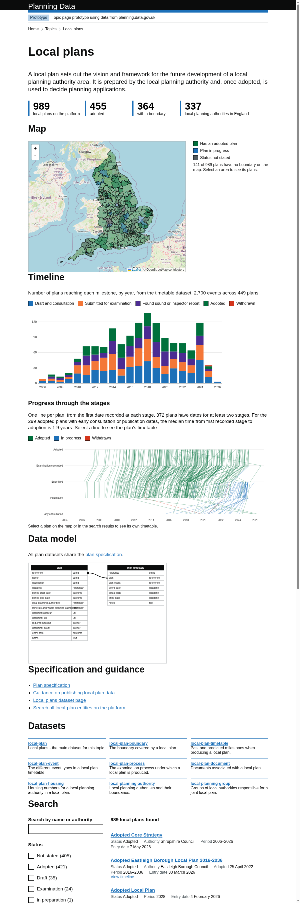

# Topic page prototype

Live prototype: <https://digital-land.github.io/topic-page/>

A prototype of a `/topic/{topic}` page for [planning.data.gov.uk](https://www.planning.data.gov.uk), for the topics `local-plan`, `minerals-plan` and `waste-plan`.

Each topic page has:

- a summary and counts of plans on the platform
- a map of the plan boundaries
- a timeline chart of plan milestones from the timetable dataset (local plans only, as the other topics have no timetable data yet)
- the plan data model diagram from the [specification](https://digital-land.github.io/specification/specification/plan/)
- links to the specification, guidance and related datasets
- search and facets over the plans

## Running

Requires Python and GNU make.

    python -m venv .venv
    .venv/bin/pip install shapely black
    make data     # fetch datasets and build data/*.json
    make serve    # http://localhost:8000/

Open `/` for the list of topics, or `/topic/local-plan` directly (redirects to `topic.html?topic=local-plan`, which also works on GitHub Pages).

## Files

| File | Purpose |
| --- | --- |
| `topics.json` | topic configuration: datasets, summary, guidance and related datasets |
| `build.py` | downloads CSVs from `files.planning.data.gov.uk` (cached in `cache/`) and writes simplified boundaries, plans and events to `data/` |
| `server.py` | static server mapping `/` to `index.html` and `/topic/*` to `topic.html?topic=*` |
| `index.html` | index of topics |
| `topic.html`, `topic.js`, `topic.css` | the topic page |

## Adding a topic

Add an entry to `topics.json` naming the plan, boundary and optional timetable datasets, then run `make data`.

## Licence

The software in this project is open source and covered by the [LICENSE](LICENSE) file.

Individual datasets copied into this repository may have specific copyright and licensing, otherwise all content and data in this repository is
[© Crown copyright](http://www.nationalarchives.gov.uk/information-management/re-using-public-sector-information/copyright-and-re-use/crown-copyright/)
and available under the terms of the [Open Government 3.0](https://www.nationalarchives.gov.uk/doc/open-government-licence/version/3/) licence.
